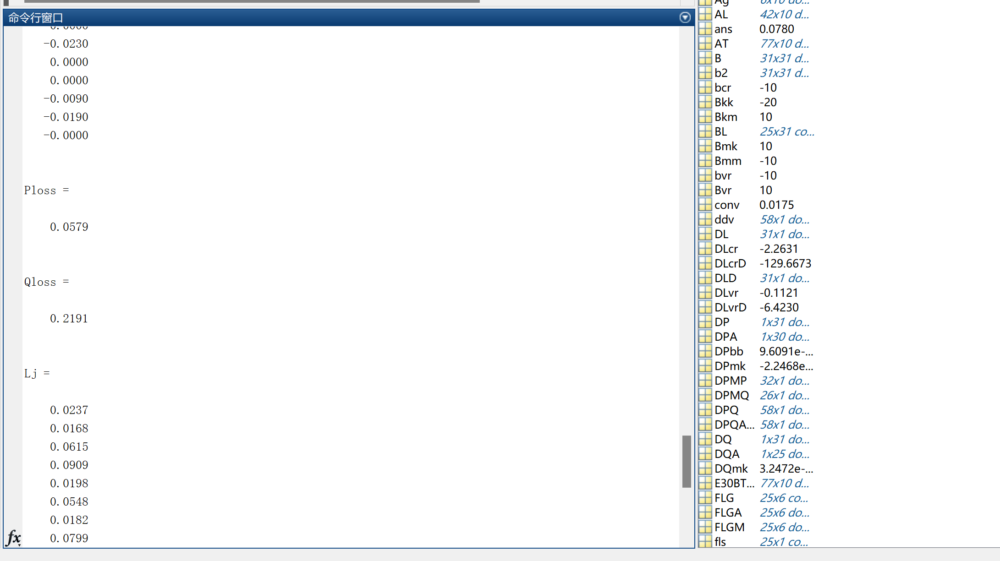

# [Utilizing UPFC for Power Loss Minimization] The UPFC model is designed to observe voltage regulation, power loss minimization, and enhanced power transmission capabilities (Matlab code).

[Utilizing UPFC for Power Loss Minimization]The UPFC model is designed to observe voltage regulation, power loss minimization, and enhanced power transmission capabilities (Matlab code).
Power Loss Minimization with UPFC [IEEE30-node Case Study]
Utilize the UPFC model to observe voltage regulation, power loss minimization, and enhanced power transmission capabilities.
Installing the UPFC model to observe voltage regulation, power loss minimization, and enhanced power transmission capabilities.
The UPFC model is a crucial member of the FACTS (Flexible AC Transmission System) equipment family. It is a solid-state converter based on microcontrollers, capable of controlling active and reactive power on transmission lines, as well as managing power flow and actual power losses. Install the UPFC model to observe voltage regulation, power loss minimization, and enhanced power transmission capabilities.

## Images

<!-- PAYMENT_BLOCK -->

## Get this dataset

- Payment link (Stripe): [Buy now](https://buy.stripe.com/3cs8yP7sY87d0vu9AB)
- Payment QR code: 

<!-- /PAYMENT_BLOCK -->
